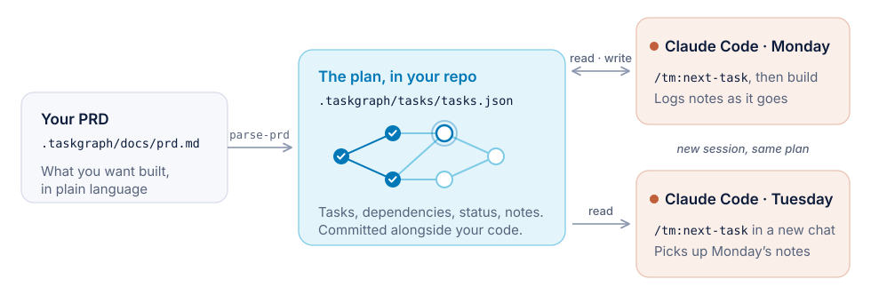

<a name="readme-top"></a>

<p align="center">
  <picture>
    <source media="(prefers-color-scheme: dark)" srcset="./images/taskgraph-logo-dark.png">
    
  </picture>
</p>

<p align="center">
<b>TaskGraph</b>: task management for AI-driven development, built for Claude Code.<br>
<a href="https://taskgraph-ai.com">Documentation</a>
</p>

<p align="center">
  <a href="https://www.npmjs.com/package/taskgraph-ai"></a>
  <a href="https://github.com/stephennmiller/taskgraph-ai/actions/workflows/ci.yml"></a>
  <a href="LICENSE"></a>
</p>

TaskGraph turns a product requirements document (PRD) into a dependency-aware
task list, then walks Claude Code through it one task at a time. You describe
what to build, TaskGraph plans the work, and Claude Code implements it, with the
plan and progress stored in your repo.

<p align="center">
  
</p>

- **Plan from a PRD:** generate tasks and subtasks, with dependencies,
  priorities and test strategies.
- **Always know what's next:** ask "What should I work on next?" and get the
  first unblocked task.
- **Just ask Claude:** with the plugin installed, say what you want in plain
  language. Slash commands (`/taskgraph:next-task`) and the `taskgraph` CLI do
  the same things when you'd rather type them.
- **No API keys:** every AI call runs through your signed-in Claude Code.

<p align="center">
  <a href="images/demo/03-pick-up-where-you-left-off.mp4"></a>
  <br>
  <sub>3. Pick up where you left off · <a href="images/demo/03-pick-up-where-you-left-off.mp4">MP4</a></sub>
</p>

<details>
<summary><b>See the full workflow</b> (4 short clips)</summary>

<p align="center">
  <a href="images/demo/01-setup.mp4"></a>
  <br>
  <sub>1. Set it up in your project · <a href="images/demo/01-setup.mp4">MP4</a></sub>
</p>

<p align="center">
  <a href="images/demo/02-prd-to-tasks.mp4"></a>
  <br>
  <sub>2. Turn your PRD into a plan · <a href="images/demo/02-prd-to-tasks.mp4">MP4</a></sub>
</p>

<p align="center">
  <a href="images/demo/03-pick-up-where-you-left-off.mp4"></a>
  <br>
  <sub>3. Pick up where you left off · <a href="images/demo/03-pick-up-where-you-left-off.mp4">MP4</a></sub>
</p>

<p align="center">
  <a href="images/demo/04-terminal.mp4"></a>
  <br>
  <sub>4. Or drive it from your terminal · <a href="images/demo/04-terminal.mp4">MP4</a></sub>
</p>

</details>

> **Attribution:** TaskGraph is based on [Task
> Master](https://github.com/eyaltoledano/claude-task-master) by Eyal Toledano
> ([@eyaltoledano](https://x.com/eyaltoledano)) and Ralph Khreish
> ([@RalphEcom](https://x.com/RalphEcom)). It is named `taskgraph-ai` with
> `taskgraph` and `taskgraph-mcp` binaries, so it can sit next to the original,
> and it keeps the original license and copyright notices (see
> [Licensing](#licensing)). Coming from Task Master, or already using
> TaskGraph's earlier slash commands? See [Upgrading](#upgrading).

## Contents

[Set up in Claude Code](#set-up-in-claude-code) · [How to use
it](#how-to-use-it) · [Commands](#commands) · [MCP tool tiers](#mcp-tool-tiers)
· [Models](#models) · [Upgrading](#upgrading) ·
[Troubleshooting](#troubleshooting) · [Privacy](#privacy) ·
[Docs](#documentation) · [Licensing](#licensing)

## Set up in Claude Code

You need [Claude Code](https://docs.claude.com/en/docs/claude-code) installed
and signed in, and Node.js 22.19 or later. To sign in, run Claude Code once:

```bash
claude
```

### 1. Install

```bash
npm install -g taskgraph-ai
```

This gives you the `taskgraph` command (the CLI) and `taskgraph-mcp`, the
optional MCP server. To try it without installing, run any command through npx:

```bash
npx -y -p taskgraph-ai taskgraph list
```

To build from source instead, see [Working on TaskGraph itself](#troubleshooting).

### 2. Initialize your project

From your own project folder:

```bash
taskgraph init
```

This creates `.taskgraph/` (tasks, docs, config) and a `CLAUDE.md` import with
TaskGraph's workflow guide (`--no-claude` skips the import). It does not install
slash commands: step 3 does. Don't run it twice; it only re-adds the same files.

`init` doesn't register the MCP server, and you don't need it. Pass `--mcp` to
add it to the project's `.mcp.json`, or see step 4.

### 3. Install the plugin

The plugin lets Claude act on plain requests about your tasks. It also adds 34
slash commands (as `/taskgraph:<name>`) and two agents (`task-executor`,
`task-checker`). In Claude Code, run:

```txt
/plugin marketplace add stephennmiller/taskgraph-ai
```

```txt
/plugin install taskgraph@taskgraph
```

The plugin does not register an MCP server. The `task-checker` agent uses the
`taskgraph show` CLI, and uses the MCP tool instead if you registered the server
as `taskgraph-ai` (step 4).

Then check the setup from your project folder. `taskgraph doctor` checks Node,
Claude Code and its sign-in, the project, the plugin and the MCP server, and
prints the fix under each one that failed:

```bash
taskgraph doctor
```

### 4. (Optional) Add the MCP server

Most people can skip this. The plugin and the CLI cover everything; the MCP
server gives Claude TaskGraph's tools directly instead of through the CLI.

```bash
claude mcp add taskgraph-ai --scope user \
  --env TASKGRAPH_TOOLS=standard \
  -- npx -y taskgraph-ai
```

Restart Claude Code, then run this in Claude Code and check that `taskgraph-ai`
shows as connected:

```txt
/mcp
```

`standard` loads 16 tools, enough for everything in
[How to use it](#how-to-use-it). See [MCP tool tiers](#mcp-tool-tiers) for the
others.

To share the setup with your team instead, put it in the project's `.mcp.json`:

```json
{
  "mcpServers": {
    "taskgraph-ai": {
      "command": "npx",
      "args": ["-y", "taskgraph-ai"],
      "env": { "TASKGRAPH_TOOLS": "standard" }
    }
  }
}
```

## How to use it

<p align="center">
  <picture>
    <source media="(prefers-color-scheme: dark)" srcset="images/how-it-works-dark.svg">
    
  </picture>
</p>

With the plugin installed, ask Claude in plain language. Each step below shows
something you can say, and the [reference table](#3-work-through-them) lists
the matching slash command and CLI command.

### 1. Write a PRD

Create `.taskgraph/docs/prd.md` describing what you want to build. The more
detail you give, the better the tasks. Skipping the PRD is fine for small jobs:
ask Claude to add a task instead.

### 2. Generate tasks

```txt
Turn .taskgraph/docs/prd.md into tasks
```

Then, optionally, check how big each task is and break the big ones down:

```txt
Analyze the complexity of the tasks and expand the complex ones into subtasks
```

### 3. Work through them

Start each session by asking what's next:

```txt
What should I work on next?
```

Then have Claude do it:

```txt
Start task 3
```

When it's finished and checked:

```txt
Mark task 3 done
```

The loop is simple: **next, implement, done, next.** Task IDs look like `3` for
a task and `3.2` for a subtask. Other things you can ask:

```txt
Why is task 7 blocked?
```

```txt
Break task 4 into subtasks
```

```txt
Add a task for rate limiting the login endpoint
```

```txt
Update task 5: we now use Postgres
```

```txt
Research JWT best practices for this project
```

The same actions as slash commands and CLI commands:

| You say | Slash command | CLI |
|---|---|---|
| What should I work on next? | `/taskgraph:next-task` | `taskgraph next` |
| Show me the task graph | `/taskgraph:graph` | `taskgraph graph` |
| Why is task 7 blocked? | `/taskgraph:why 7` | `taskgraph why 7` |
| Show task 1 | `/taskgraph:show-task 1` | `taskgraph show 1` |
| Start task 3 | `/taskgraph:to-in-progress 3` | `taskgraph set-status --id=3 --status=in-progress` |
| Mark task 3 done | `/taskgraph:to-done 3` | `taskgraph set-status --id=3 --status=done` |
| Break task 4 into subtasks | `/taskgraph:expand-task 4` | `taskgraph expand --id=4` |
| Add a task for ... | `/taskgraph:add-task <what you want>` | `taskgraph add-task --prompt='...'` |
| Update task 5: ... | `/taskgraph:update-task 5 <change>` | `taskgraph update 5 --prompt='...'` |
| Research ... | (research skill) | `taskgraph research "JWT best practices"` |

If you use the MCP server instead, research, tags and the dependency editing
tools (`add_dependency`, `remove_dependency`, `validate_dependencies`,
`fix_dependencies`) load only with `TASKGRAPH_TOOLS=all`. `dependency_analysis`
is in `standard` (see [MCP tool tiers](#mcp-tool-tiers)), and everything else
here works with `standard`.

### 4. Keep it organized

- **Tags** keep separate task lists per branch, feature or experiment. Ask:

  ```txt
  Make a tag for the auth rewrite
  ```

  The CLI commands are `taskgraph tags`, `taskgraph tags add` and
  `taskgraph tags use` (MCP: `list_tags`, `add_tag`, `use_tag`).
- **Dependencies** decide what counts as "next". If the graph looks wrong, ask:

  ```txt
  Check the task dependencies and fix any problems
  ```

- **Statuses:** `pending`, `in-progress`, `review`, `done`, `blocked`,
  `deferred`, `cancelled`.

## Commands

Plain requests to Claude, slash commands and the `taskgraph` CLI all reach the
same actions.

### Slash commands

Install the plugin (step 3) and they appear as `/taskgraph:<name>`.
`taskgraph init` does not write slash commands. To see them all, type this in
Claude Code:

```txt
/taskgraph
```

| Purpose | Commands |
|---|---|
| Set up | `init-project`, `install-taskgraph`, `setup-models`, `view-models` |
| Plan | `parse-prd`, `parse-prd-with-research`, `analyze-complexity`, `complexity-report` |
| See | `list-tasks`, `next-task`, `show-task`, `project-status` |
| Change status | `set-status`, `to-in-progress`, `to-done` |
| Edit | `add-task`, `update-task`, `update-tasks-from-id`, `remove-task`, `convert-task-to-subtask` |
| Subtasks | `expand-task`, `expand-all-tasks`, `add-subtask`, `remove-subtask`, `clear-subtasks` |
| Dependencies | `graph`, `why`, `add-dependency`, `remove-dependency`, `validate-dependencies`, `fix-dependencies` |
| Other | `sync-readme`, `help` |

### CLI cheat sheet

```bash
taskgraph parse-prd .taskgraph/docs/prd.md   # generate tasks from a PRD
taskgraph list                               # all tasks and their status
taskgraph next                               # next task to work on
taskgraph graph                              # tasks as a dependency tree
taskgraph why 7                              # why task 7 is blocked
taskgraph show 1,3,5                         # one or more tasks
taskgraph set-status --id=3 --status=done    # change status
taskgraph add-task --prompt='...' --research # add a task
taskgraph expand --id=4 --research           # split into subtasks
taskgraph expand --all                       # expand every eligible task
taskgraph update 5 --prompt='...'            # change one task
taskgraph update --from=5 --prompt='...'     # change task 5 onward
taskgraph note 3.2 'chose argon2'            # log progress, as written
taskgraph analyze-complexity --research
taskgraph analyze-complexity --report
taskgraph add-dependency --id=5 --depends-on=3
taskgraph validate-dependencies
taskgraph move --from=5 --from-tag=backlog --to-tag=in-progress
taskgraph research "latest JWT best practices"
taskgraph models --setup                     # choose models
taskgraph completion --install               # Tab completion for your shell
taskgraph doctor                             # check the setup, with fixes
```

For Tab completion of commands, flags, task IDs, tags and statuses in bash,
zsh or fish, run this once, and again after upgrading:

```bash
taskgraph completion --install
```

Every command, flag and example is in the [command reference](https://taskgraph-ai.com/capabilities/cli-root-commands).

## MCP tool tiers

Only relevant if you added the optional MCP server. Each tool you load costs
context. `TASKGRAPH_TOOLS` controls how many are registered. If it's unset, you
get `core`.

| Value | Tools | Includes |
|---|---|---|
| `core` (default, alias `lean`) | 7 | `get_tasks`, `next_task`, `get_task`, `set_task_status`, `add_note`, `parse_prd`, `expand_task` |
| `standard` | 16 | core, plus `update_subtask`, `initialize_project`, `analyze_project_complexity`, `expand_all`, `add_subtask`, `remove_task`, `add_task`, `complexity_report`, `dependency_analysis` |
| `all` | 40 | everything: updates, dependencies, archive, tags, `research`, `move_task`, `scope_up_task`, `scope_down_task` and `generate` |
| a list | custom | e.g. `get_tasks,next_task,set_task_status` |

`all` registers every tool. That gives the MCP host full project control: it
can create, edit and delete tasks and tags, change settings, generate task
files and write to GitHub. Prefer `core` or `standard` unless you need a tool
only `all` includes.

Set it when you add the server. `core` is the default:

```bash
claude mcp add taskgraph-ai --scope user \
  --env TASKGRAPH_TOOLS=core \
  -- npx -y taskgraph-ai
```

Or edit the `env` block in `.mcp.json`, then restart Claude Code.

## Models

TaskGraph uses three roles: **main**, **research** and **fallback** (used if
either of the others fails). The choices are `opus`, `sonnet` and `haiku`. The
research role gets web search and fetch only. It cannot read or change your
files and has no shell.

To change a model, ask Claude:

```txt
Change the main model to opus
```

Or pick them in a terminal:

```bash
taskgraph models --setup
```

Details are in [Models](docs/models.md) and the
[Claude Code guide](https://taskgraph-ai.com/capabilities/claude-code).

## Upgrading

**Slash commands now come from the plugin (every existing project).**
`taskgraph init --rules claude` no longer writes slash commands into
`.claude/commands/tm/`. Install the plugin ([step 3](#3-install-the-plugin)),
then refresh it in Claude Code:

```txt
/plugin marketplace update taskgraph
```

Then run init once more. It removes the old TaskGraph command files and keeps
any you added:

```bash
taskgraph init --rules claude
```

Details are in the
[upgrade guide](https://taskgraph-ai.com/upgrading#5-move-slash-commands-to-the-plugin).

Projects created with Task Master, or with a TaskGraph release before 0.47, also
need a few manual changes:

- **Import `.taskmaster/`.** It copies every tag, the docs and reports, and
  the settings that still apply, and leaves `.taskmaster/` in place. See
  [Migrating from Task Master](https://taskgraph-ai.com/migrating-from-taskmaster).

  ```bash
  taskgraph init --from-taskmaster --yes
  ```

- **Rename environment variables:** `TASK_MASTER_*` and `TASKMASTER_*` are now
  `TASKGRAPH_*`. The old names are ignored.
- **Removed:** the `taskgraph migrate` command and `.taskmasterconfig`.
  Configuration lives in `.taskgraph/config.json`; run
  `taskgraph models --setup` to recreate it.
- **Claude Code only:** other providers and their flags are gone, models are
  `opus`, `sonnet` and `haiku`, and the only API key still read is the optional
  `CLAUDE_CODE_API_KEY`.

Full details are in the [upgrade guide](https://taskgraph-ai.com/upgrading).

## Troubleshooting

**Something in the setup doesn't work.** Run this; it prints a line per setup
step and the fix under each one that failed:

```bash
taskgraph doctor
```

**AI commands fail.** Run Claude Code once and make sure you're signed in:

```bash
claude
```

**Task files look out of sync.** Ask Claude to fix the task dependencies, or
run:

```bash
taskgraph fix-dependencies
```

Don't hand-edit `.taskgraph/tasks/tasks.json` or `.taskgraph/config.json`; ask
Claude or use the commands.

**`0 tools enabled`, or the MCP server won't connect.** Restart Claude Code and
run `/mcp`. Then check that the server starts on its own in a terminal. It
waits for input; press Ctrl+C to stop it. If it exits instead, its error names
the problem, such as an unknown `TASKGRAPH_TOOLS` tier or tool name.

```bash
npx -y taskgraph-ai
```

**Fewer MCP tools than expected.** `TASKGRAPH_TOOLS` defaults to `core`. Set
`standard` or `all` (see [MCP tool tiers](#mcp-tool-tiers)).

**Working on TaskGraph itself.** Build from source:

```bash
git clone https://github.com/stephennmiller/taskgraph-ai.git
cd taskgraph-ai
npm install
npm run build
```

Then run the CLI from the build:

```bash
node dist/taskgraph.js
```

This repository's own `.mcp.json` starts `dist/mcp-server.js` with
`TASKGRAPH_TOOLS=core`, so build first or the server won't connect. After a
`git pull`, run `npm run build` again; the CLI and server run from `dist/`.

## Privacy

TaskGraph has no account, server or telemetry. Tasks stay in `.taskgraph/` in
your project. Data leaves your machine only in these cases:

- AI commands go through your own Claude Code to Anthropic, with the task text,
  a short project summary and the project files Claude reads. `loop` runs
  Claude Code with permission prompts off, so it can send anything your Claude
  Code can.
- The CLI checks `registry.npmjs.org` for updates and fetches release notes
  from `raw.githubusercontent.com`. It tells you when a newer version is out
  and installs it only when you run `taskgraph upgrade` or opt in with
  `TASKGRAPH_AUTO_UPDATE=install` (`TASKGRAPH_SKIP_AUTO_UPDATE=1` skips the
  check).
- `loop --parallel --container` installs TaskGraph from npm inside the
  container when its image doesn't have it.
- The research skill and command search and fetch web pages.
- GitHub sync reads and writes GitHub Issues through your `gh` CLI.

The plugin's SessionStart hook adds the task in progress, the tasks ready next
and TaskGraph's workflow rules to Claude's context, all printed by your locally
installed `taskgraph prime`. The plugin's hooks make no network calls. Details:
[taskgraph-ai.com/privacy](https://taskgraph-ai.com/privacy).

## Documentation

[Tutorial](https://taskgraph-ai.com/tutorial) · [Command
reference](https://taskgraph-ai.com/capabilities/cli-root-commands) ·
[Configuration](https://taskgraph-ai.com/configuration) · [Task
structure](https://taskgraph-ai.com/capabilities/task-structure) ·
[Examples](https://taskgraph-ai.com/examples) · [Models](docs/models.md) ·
[Upgrading](https://taskgraph-ai.com/upgrading) ·
[Plugin](CLAUDE_CODE_PLUGIN.md) · [Contributing](CONTRIBUTING.md) ·
[Changelog](CHANGELOG.md)

## Contributors

<a href="https://github.com/stephennmiller/taskgraph-ai/graphs/contributors">
  
</a>

## Licensing

TaskGraph is licensed under the MIT License with Commons Clause, the same
license as Task Master. The Commons Clause does not grant the right to Sell
the software.

**Allowed:** use it for any purpose (personal, commercial, academic), modify it,
distribute copies, and sell products built with it when that is not Selling
the software.

**Not allowed:** Selling the software. "Sell" means practicing any or all of
the rights granted under the license to provide the software to third parties,
for a fee or other consideration (including without limitation fees for hosting
or consulting/support services related to the software), as part of a product
or service whose value derives, entirely or substantially, from the
functionality of the software.

See [LICENSE](LICENSE) and [licensing details](docs/licensing.md).
