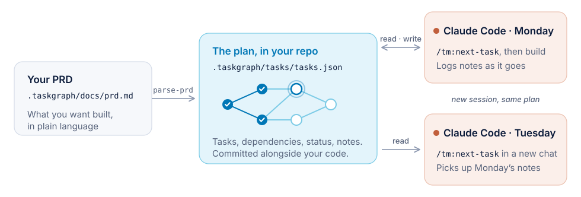

<!-- markdownlint-disable MD013 MD033 MD041 -->
<a name="readme-top"></a>

<p align="center">
  <picture>
    <source media="(prefers-color-scheme: dark)" srcset="./images/taskgraph-logo-dark.png">
    
  </picture>
</p>

<p align="center">
<b>TaskGraph</b>: task management for AI-driven development, built for Claude Code.<br>
<a href="https://taskgraph-ai.com">Documentation</a>
</p>

<p align="center">
  <a href="https://www.npmjs.com/package/taskgraph-ai"></a>
  <a href="https://github.com/stephennmiller/taskgraph-ai/actions/workflows/ci.yml"></a>
  <a href="LICENSE"></a>
</p>

TaskGraph turns a product requirements document (PRD) into a dependency-aware
task list, then walks Claude Code through it one task at a time. You describe
what to build, TaskGraph plans the work, and Claude Code implements it, with the
plan and progress stored in your repo.

<p align="center">
  
</p>

- **Plan from a PRD:** generate tasks and subtasks, with dependencies,
  priorities and test strategies.
- **Always know what's next:** ask "What should I work on next?" and get the
  first unblocked task.
- **Just ask Claude:** with the plugin installed, say what you want in plain
  language. Slash commands (`/taskgraph:next`) and the `taskgraph` CLI do
  the same things when you'd rather type them.
- **No API keys:** every AI call runs through your signed-in Claude Code.
- **Resumable long builds:** stop a build partway and `taskgraph loop` picks
  up from the task statuses. See [Pros and cons](#pros-and-cons) for what it
  costs.

<p align="center">
  <a href="images/demo/03-pick-up-where-you-left-off.mp4"></a>
  <br>
  <sub>Pick up where you left off · <a href="images/demo/03-pick-up-where-you-left-off.mp4">MP4</a></sub>
</p>

<details>
<summary><b>See the full workflow</b> (5 short clips)</summary>

<p align="center">
  <a href="images/demo/01-setup.mp4"></a>
  <br>
  <sub>1. Set it up in your project · <a href="images/demo/01-setup.mp4">MP4</a></sub>
</p>

<p align="center">
  <a href="images/demo/02-prd-to-tasks.mp4"></a>
  <br>
  <sub>2. Turn your PRD into a plan · <a href="images/demo/02-prd-to-tasks.mp4">MP4</a></sub>
</p>

<p align="center">
  <a href="images/demo/03-pick-up-where-you-left-off.mp4"></a>
  <br>
  <sub>3. Pick up where you left off · <a href="images/demo/03-pick-up-where-you-left-off.mp4">MP4</a></sub>
</p>

<p align="center">
  <a href="images/demo/04-terminal.mp4"></a>
  <br>
  <sub>4. Or drive it from your terminal · <a href="images/demo/04-terminal.mp4">MP4</a></sub>
</p>

<p align="center">
  <a href="images/demo/05-go.mp4"></a>
  <br>
  <sub>5. Or hand it the whole PRD · <a href="images/demo/05-go.mp4">MP4</a></sub>
</p>

</details>

<!-- markdownlint-enable MD013 -->

> **Attribution:** TaskGraph is based on [Task
> Master](https://github.com/eyaltoledano/claude-task-master) by Eyal Toledano
> ([@eyaltoledano](https://x.com/eyaltoledano)) and Ralph Khreish
> ([@RalphEcom](https://x.com/RalphEcom)). It is named `taskgraph-ai` with
> `taskgraph` and `taskgraph-mcp` binaries, so it can sit next to the original,
> and it keeps the original license and copyright notices (see
> [Licensing](#licensing)). Coming from Task Master, or already using
> TaskGraph's earlier slash commands? See [Upgrading](#upgrading).

## Pros and cons

On our [benchmarks][benchmarks], long builds scored by hidden tests against
a real tool, TaskGraph ties or trails plain Claude Code
on score and costs more: about 60% more with one task per session. What it
buys is a plan you can read and review in the repo, and a clean resume: after
an interruption `taskgraph loop` comes close to its uninterrupted score, for
14% more than an uninterrupted run, against almost three times as much with
plain `claude --continue`.

Use TaskGraph when a build is long enough that you will stop and resume it,
or when you want the plan and its progress kept in the repo. For a build that
fits in one sitting, plain Claude Code is cheaper and just as good.

## Contents

[Pros and cons](#pros-and-cons) · [Set up in Claude
Code](#set-up-in-claude-code) · [How to use it](#how-to-use-it) ·
[Reference](#reference) · [Upgrading](#upgrading) · [Privacy](#privacy) ·
[Docs](#documentation) · [Licensing](#licensing)

## Set up in Claude Code

You need [Claude Code](https://docs.claude.com/en/docs/claude-code) installed
and signed in, and Node.js 22.19 or later. To sign in, run Claude Code once:

```bash
claude
```

### 1. Install

```bash
npm install -g taskgraph-ai
```

This gives you the `taskgraph` command (the CLI) and `taskgraph-mcp`, the
optional MCP server. To try it without installing, run any command through npx:

```bash
npx -y -p taskgraph-ai taskgraph list
```

To build from source instead, see
[Working on TaskGraph itself][troubleshooting].

### 2. Initialize your project

From your own project folder:

```bash
taskgraph init
```

This creates `.taskgraph/` (tasks, docs, config) and a `CLAUDE.md` import with
TaskGraph's workflow guide (`--no-claude` skips the import). It does not install
slash commands: step 3 does. Don't run it twice; it only re-adds the same files.

### 3. Install the plugin

The plugin lets Claude act on plain requests about your tasks. It also adds 16
slash commands (as `/taskgraph:<name>`) and two agents (`task-executor`,
`task-checker`). In Claude Code, run:

```txt
/plugin marketplace add stephennmiller/taskgraph-ai
```

```txt
/plugin install taskgraph@taskgraph
/plugin install taskgraph-hooks@taskgraph
```

Then check the setup from your project folder. `taskgraph doctor` checks Node,
Claude Code and its sign-in, the project, its data files and tasks, the plugin
and the MCP server, and prints the fix under each one that failed
(`taskgraph doctor --fix` repairs the task problems that have one safe answer):

```bash
taskgraph doctor
```

### 4. (Optional) Add the MCP server

Most people can skip this. The plugin and the CLI cover everything; the MCP
server gives Claude TaskGraph's tools directly instead of through the CLI.

```bash
claude mcp add taskgraph-ai --scope user \
  --env TASKGRAPH_TOOLS=standard \
  -- npx -y taskgraph-ai
```

Restart Claude Code and run `/mcp` to check that `taskgraph-ai` is connected.
`standard` loads 16 tools, enough for everything in
[How to use it](#how-to-use-it). The [installation guide][installation] has
the shared `.mcp.json` setup, and [MCP tool tiers][mcp-tiers] the others.

## How to use it

<p align="center">
  <picture>
    <source media="(prefers-color-scheme: dark)" srcset="images/how-it-works-dark.svg">
    <!-- markdownlint-disable-next-line MD013 -->
    
  </picture>
</p>

With the plugin installed, ask Claude in plain language. The
[quick reference][quick-reference] lists the matching slash command and CLI
command for each request.

### 1. Write a PRD

Create `.taskgraph/docs/prd.md` describing what you want to build. The more
detail you give, the better the tasks. Skipping the PRD is fine for small jobs:
ask Claude to add a task instead.

### 2. Generate tasks

```txt
Turn .taskgraph/docs/prd.md into tasks
```

Then, optionally, check how big each task is and break the big ones down:

```txt
Analyze the complexity of the tasks and expand the complex ones into subtasks
```

### 3. Work through them

Start each session by asking what's next:

```txt
What should I work on next?
```

Then have Claude do it:

```txt
Start task 3
```

When it's finished and checked:

```txt
Mark task 3 done
```

The loop is simple: **next, implement, done, next.** You can also ask why a
task is blocked, to break a task into subtasks, to add or update a task, or to
research something for the project.

### Or let it build unattended

To plan a PRD and have Claude Code work through every task on its own, run:

```bash
taskgraph go .taskgraph/docs/prd.md
```

It runs `parse-prd`, then `taskgraph loop`, which works the tasks in order and
commits after each. If it stops partway, run `taskgraph loop` again and it
picks up from the task statuses. Add `--trust` to run with Claude Code's
permission prompts off.

## Reference

On the docs site:

- [Commands][quick-reference]: every slash command and CLI command, a cheat
  sheet, tags, dependencies and statuses.
- [MCP tool tiers][mcp-tiers]: what `TASKGRAPH_TOOLS` loads.
- [Models][models]: the main, research and fallback roles.
- [Troubleshooting][troubleshooting]: `doctor`, sign-in, MCP connection
  problems and building from source.
- [Benchmarks][benchmarks]: the full results behind
  [Pros and cons](#pros-and-cons).

## Upgrading

Slash commands now come from the plugin, and Task Master projects import with
`taskgraph init --from-taskmaster --yes`. The [upgrade guide][upgrading] has
the steps for every existing project, and [Migrating from Task
Master][migrating] what moves.

## Privacy

TaskGraph has no account, server or telemetry. Tasks stay in `.taskgraph/` in
your project. AI commands go through your own Claude Code to Anthropic; the
[privacy page][privacy] lists everything that leaves your machine.

## Documentation

[Tutorial](https://taskgraph-ai.com/tutorial) · [Command
reference](https://taskgraph-ai.com/capabilities/cli-root-commands) ·
[Configuration](https://taskgraph-ai.com/configuration) · [Task
structure](https://taskgraph-ai.com/capabilities/task-structure) ·
[Examples](https://taskgraph-ai.com/examples) · [Models](docs/models.md) ·
[Upgrading](https://taskgraph-ai.com/upgrading) ·
[Plugin](CLAUDE_CODE_PLUGIN.md) · [Contributing](CONTRIBUTING.md) ·
[Changelog](CHANGELOG.md)

## Contributors

<a href="https://github.com/stephennmiller/taskgraph-ai/graphs/contributors">
  <!-- markdownlint-disable-next-line MD013 -->
  
</a>

## Licensing

TaskGraph is licensed under the MIT License with Commons Clause, the same
license as Task Master. The Commons Clause does not grant the right to Sell
the software.

**Allowed:** use it for any purpose (personal, commercial, academic), modify it,
distribute copies, and sell products built with it when that is not Selling
the software.

**Not allowed:** Selling the software. "Sell" means practicing any or all of
the rights granted under the license to provide the software to third parties,
for a fee or other consideration (including without limitation fees for hosting
or consulting/support services related to the software), as part of a product
or service whose value derives, entirely or substantially, from the
functionality of the software.

See [LICENSE](LICENSE) and [licensing details](docs/licensing.md).

[benchmarks]: https://taskgraph-ai.com/best-practices/benchmarks
[installation]: https://taskgraph-ai.com/getting-started/quick-start/installation
[mcp-tiers]: https://taskgraph-ai.com/capabilities/mcp#tool-tiers-at-a-glance
[migrating]: https://taskgraph-ai.com/migrating-from-taskmaster
[models]: https://taskgraph-ai.com/capabilities/claude-code#models
[privacy]: https://taskgraph-ai.com/privacy
[quick-reference]: https://taskgraph-ai.com/capabilities/cli-root-commands#quick-reference
[troubleshooting]: https://taskgraph-ai.com/getting-started/faq#troubleshooting
[upgrading]: https://taskgraph-ai.com/upgrading
