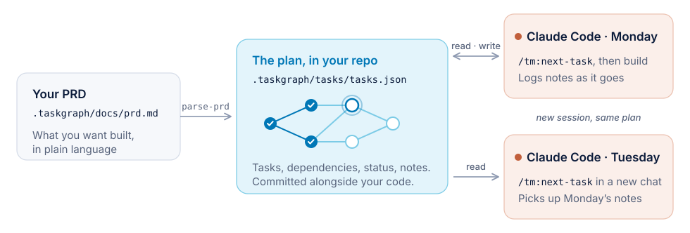
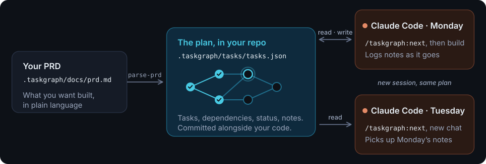

<Tip>
Welcome to v1 of the TaskGraph Docs. Expect weekly updates as we expand and refine each section.
</Tip>

TaskGraph turns your PRD into a task graph stored in `.taskgraph/tasks/tasks.json` in your repo. Each Claude Code session reads and updates that file, so a new session picks up the next task and the notes from the last one.

<Frame>
  
  
</Frame>

## See it work

<Tabs>
  <Tab title="1. Set up">
    <Frame caption="Run taskgraph init in your project">
      
    </Frame>
  </Tab>
  <Tab title="2. Plan">
    <Frame caption="Turn your PRD into a plan">
      
    </Frame>
  </Tab>
  <Tab title="3. Resume">
    <Frame caption="Pick up where you left off">
      
    </Frame>
  </Tab>
  <Tab title="4. Terminal">
    <Frame caption="Or drive it from your terminal">
      
    </Frame>
  </Tab>
  <Tab title="5. Build it all">
    <Frame caption="Or hand it the whole PRD with taskgraph go">
      
    </Frame>
  </Tab>
</Tabs>

We've organized the docs into three sections depending on your experience level and goals:

### Getting Started - Jump in to [Quick Start](/getting-started/quick-start/quick-start)
Designed for first-time users. Get set up, create your first PRD, and run your first task.

### Best Practices
Covers common workflows, strategic usage of commands, model configuration tips, and real-world usage patterns. Recommended for active users.

### Technical Capabilities
A detailed glossary of every root command and available capability — meant for power users and contributors.

---

Thanks for being here early. If you spot something broken or want to contribute, check out the [GitHub repo](https://github.com/stephennmiller/taskgraph-ai).